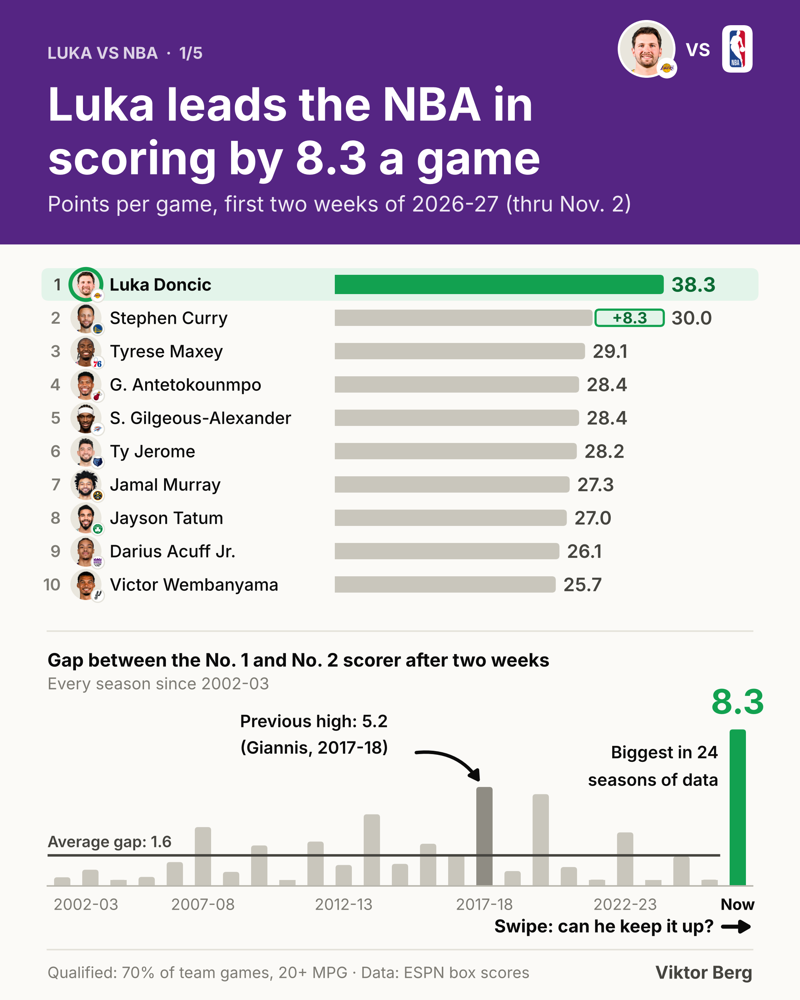
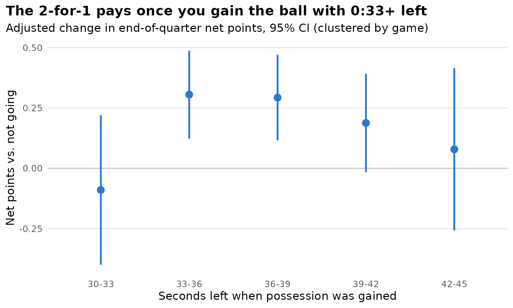

# NBA Analysis

NBA data stories by **Viktor Berg**: each folder is one project with its data, code, calculations and output, rebuildable from scratch.

| [Luka vs NBA: the 2026-27 hot start](luka-hot-start-2026-27/) | [The 2-for-1 Ledger](nba-2for1-analysis/) |
|---|---|
|  |  |

| Project | Question | Output | Tools |
|---|---|---|---|
| [Luka vs NBA: the 2026-27 hot start](luka-hot-start-2026-27/) | Luka opened at 38.3 PPG. How unusual is it, can he keep it up, and is he the MVP favorite? | 5-slide LinkedIn carousel | Python, Excel |
| [The 2-for-1 Ledger](nba-2for1-analysis/) | How much is going 2-for-1 at the end of a quarter worth, and when does it stop working? | Case-study report, 3 charts (simulated play-by-play) | SQL (DuckDB), R, Python |

**Toolkit:** Python (pandas, NumPy, matplotlib), SQL (DuckDB), R (ggplot2, sandwich), Excel, ESPN and sportsdataverse public data. Every project folder has a `run_all.sh` that rebuilds its numbers and output from scratch. Carousel projects also have a `setup.sh` and a workbook where each number on a slide traces back to a formula.
