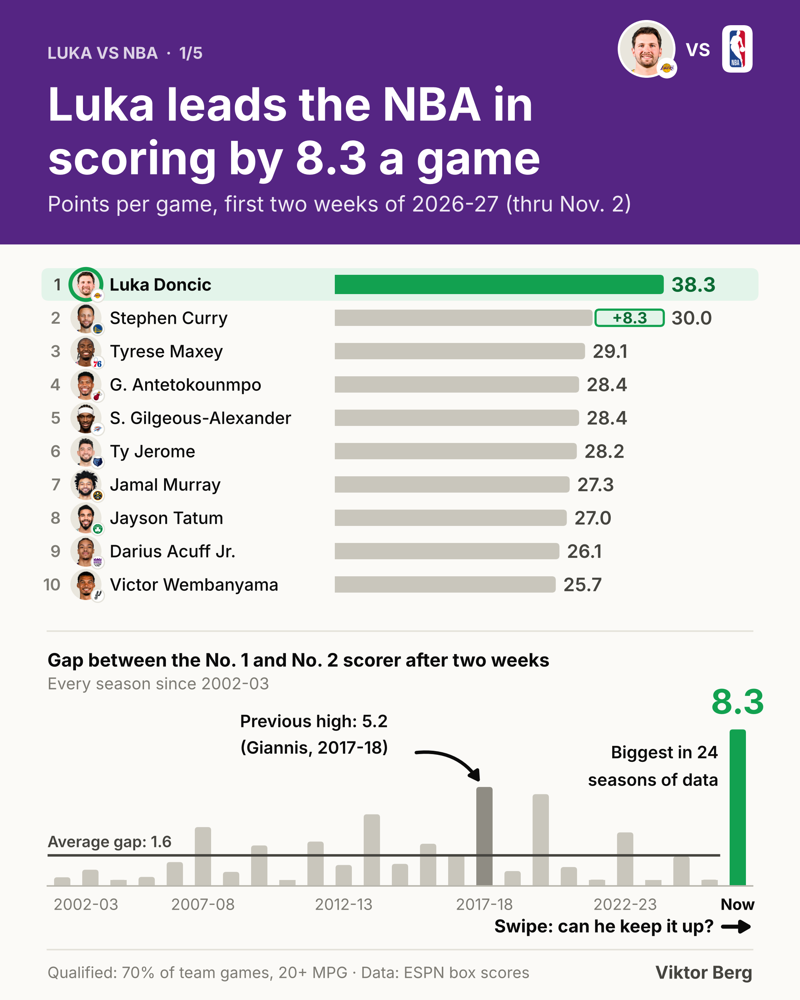
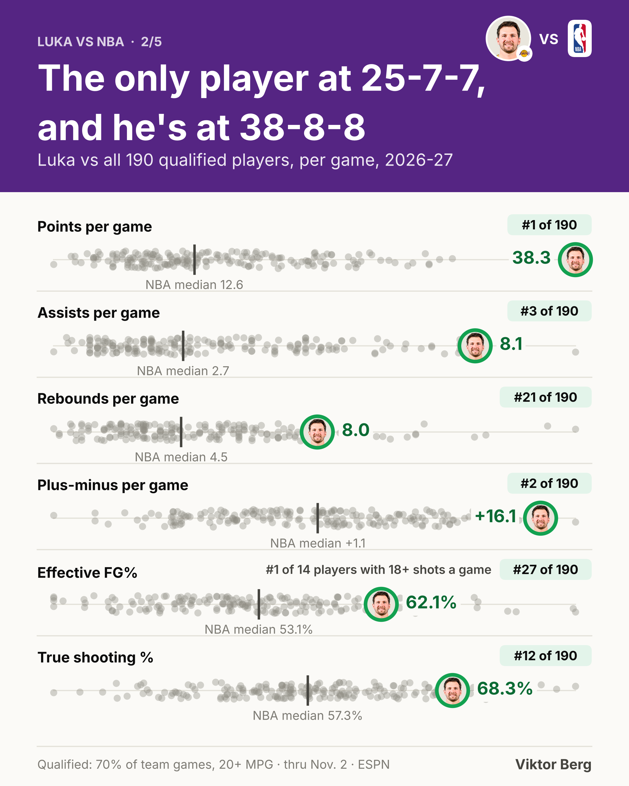
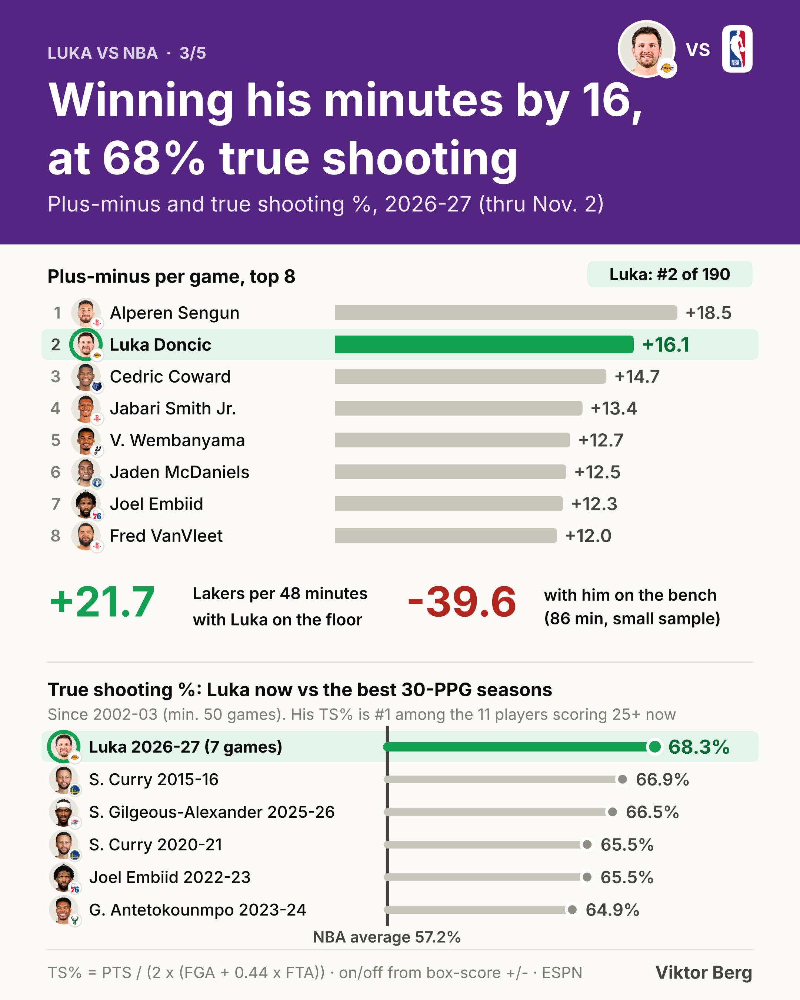
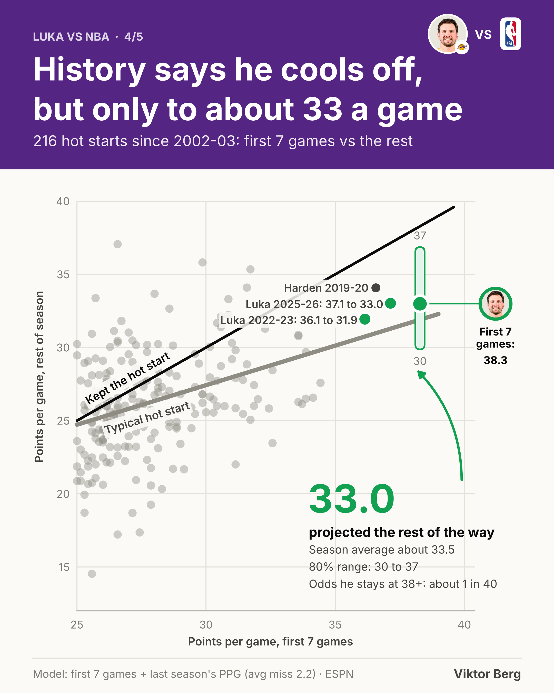
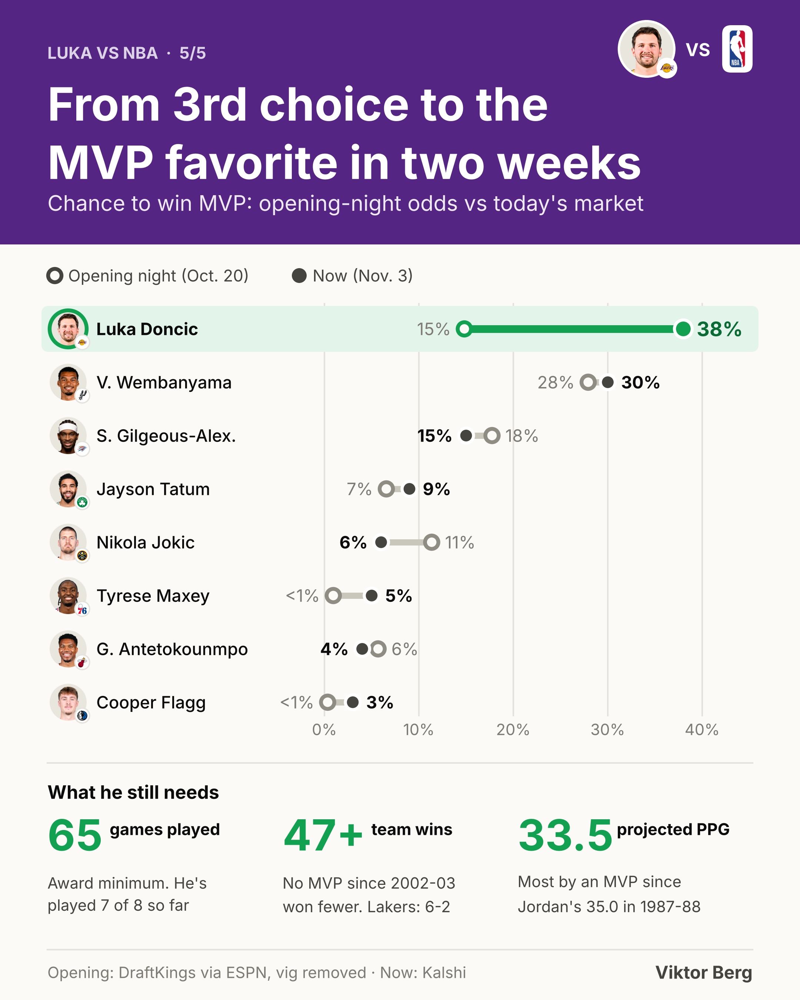

# Luka vs NBA: the 2026-27 hot start

Luka Dončić opened the 2026-27 season at **38.3 points per game** over his first 7 games, **8.3 more than anyone else** in the league. This project measures how unusual that is, whether it can last, and what it means for the MVP race.

**LinkedIn post:** _link coming_ · **Carousel (PDF):** [slides/Luka_vs_NBA_carousel.pdf](slides/Luka_vs_NBA_carousel.pdf) · **Workbook (every number, with formulas):** [data/Luka_vs_NBA_data.xlsx](data/Luka_vs_NBA_data.xlsx)

Data snapshot: all 2026-27 regular-season games through **Nov. 2, 2026** (107 games).

---

## The slides

| | |
|---|---|
|  |  |
| **1. Luka leads the NBA in scoring by 8.3 a game.** The gap between the No. 1 and No. 2 scorer two weeks into a season has averaged 1.6 since 2002-03. The previous high was 5.2 (Giannis, 2017-18). | **2. The only player at 25-7-7, and he's at 38-8-8.** Luka vs all 190 qualified players: #1 in points, #3 in assists, #2 in plus-minus. |
|  |  |
| **3. Winning his minutes by 16, at 68% true shooting.** Lakers +21.7 per 48 with him on the floor, -39.6 with him on the bench. His 68.3% TS is above every 30-PPG season since 2002-03. | **4. History says he cools off, but only to about 33 a game.** 216 hot starts since 2002-03. Projection: 33.0 the rest of the way, about 33.5 for the season. |
|  | |
| **5. From 3rd choice to the MVP favorite in two weeks.** 15% on opening night to 38% now. Still needed: 65 games and 47+ team wins. | |

## Key numbers

| Metric | Luka | Context |
|---|---|---|
| Points per game | **38.3** (268 pts / 7 games) | #1 of 190; No. 2 is Stephen Curry at 30.0 |
| Gap to No. 2 | **+8.3** | Average two-week gap since 2002-03: 1.6; previous high 5.2 |
| Assists / rebounds per game | **8.1 / 8.0** | #3 and #21 of 190; only qualified player at 25-7-7 |
| Plus-minus per game | **+16.1** | #2 of 190 (Alperen Sengun +18.5) |
| Lakers net per 48 min, Luka on / off | **+21.7 / -39.6** | 250 minutes on, 86 off (small sample) |
| Effective FG% | **62.1%** | #1 of 14 players taking 18+ shots a game; league 53.3% |
| True shooting % | **68.3%** | #1 of 11 players scoring 25+; best 30-PPG season since 2002-03 is Curry 2015-16 at 66.9% |
| Projected rest-of-season PPG | **33.0** | 80% range 29.9 to 36.9 |
| Projected season average | **33.5** | Would be the most by an MVP since Michael Jordan's 35.0 (1987-88) |
| MVP chance | **38%** (Kalshi, Nov. 3) | 14.8% on opening night (DraftKings via ESPN, Oct. 20), 3rd behind Wembanyama and SGA |
| Lakers record | **6-2** (5-2 in his games) | Preseason win total 46.5 |

## How the numbers are calculated

**Qualified player.** Played at least 70% of his team's games and averaged 20+ minutes (190 players).

**Shooting efficiency.**
- Effective FG% = (FGM + 0.5 x 3PM) / FGA. Luka: (82 + 0.5 x 41) / 165 = **62.1%**
- True shooting % = PTS / (2 x (FGA + 0.44 x FTA)). Luka: 268 / (2 x (165 + 0.44 x 71)) = **68.3%**

**On/off (slide 3).** On-court margin is the sum of Luka's box-score plus-minus (+113 in 250 minutes). Off-court margin = the Lakers' total margin in his 7 games (+42) minus his on-court margin = -71 in 86 minutes. Per 48: 113 / 250 x 48 = **+21.7**; -71 / 86 x 48 = **-39.6**.

**Scoring gap history (slide 1).** For every season since 2002-03, I took the first 14 days of the season (opening day + 13, matching this season's Oct. 20 to Nov. 2), applied the same qualification rule, and measured the PPG gap between the top two scorers. The early leader went on to win the scoring title in 5 of 24 seasons.

**Hot-start model (slide 4).**
- Sample: every player-season since 2002-03 with **25+ PPG over a player's first 7 games** and 30+ games afterward (216 player-seasons).
- Model (ordinary least squares, n = 197 with a 40+ game prior season):
  `rest-of-season PPG = 7.037 + 0.311 x first-7 PPG + 0.420 x last season's PPG`
- Luka: 7.037 + 0.311 x 38.3 + 0.420 x 33.5 = **33.0** the rest of the way.
- Season average assuming 70 games: (268 + 33.0 x 63) / 70 = **33.5** (65 or 75 games changes it by less than 0.1).
- Validation: leave-one-out average miss **2.2 PPG** (RMSE 2.8). Assuming the hot start holds misses by 3.1 on average and overshoots by 1.7.
- Range and odds come from the 197 leave-one-out errors: 80% range 29.9 to 36.9 the rest of the way. Holding 38.3 for the season would require a 38.3 pace the rest of the way, which happened in 2.5% of cases (**about 1 in 40**).
- His own history agrees: his last two 36+ starts cooled by about 4 (37.1 to 33.0 in 2025-26, 36.1 to 31.9 in 2022-23).

**MVP market (slide 5).** Opening-night American odds converted to implied probability (100 / (odds + 100)), then normalized across the 20 listed players to remove the bookmaker margin (the raw total was 117.4%). Example: Luka +475 gives 100 / 575 = 17.4%, divided by 1.174 = **14.8%**. "Now" is the Kalshi market price on Nov. 3, 2026.

**MVP benchmarks.** Every MVP from 2002-03 to 2025-26: fewest team wins (scaled to 82 games) was **47** (Westbrook 2016-17); fewest games played was 62; highest scoring average was 33.1 (Embiid 2022-23). The 65-game minimum for awards is the league rule (Luka was granted eligibility on appeal in 2025-26 at 64 games).

## Data sources

- 2026-27 box scores: ESPN public scoreboard and game summary API (`site.api.espn.com`), games through Nov. 2, 2026.
- 2002-03 to 2025-26 box scores and schedules: [sportsdataverse ESPN NBA data](https://github.com/sportsdataverse/sportsdataverse-data/releases). All-Star games and NBA Cup finals removed (the Cup final doesn't count in regular-season stats).
- MVP odds: [ESPN / DraftKings, Oct. 20, 2026](https://www.espn.com/espn/betting/story/_/id/50230164/nba-championship-mvp-betting-odds-2026-2027) and [Kalshi](https://kalshi.com/nba/mvp-odds), Nov. 3, 2026.
- Lakers win total: [Complex / Fanatics, Oct. 21, 2026](https://www.complex.com/bets/a/matt-burke/lakers-odds-title-luka-mvp-win-totals).
- Logos and headshots: ESPN CDN.

## Quality checks

- Luka's 7 games sum to 268 points (38.3 PPG), matching public reporting.
- Scoring champions 2002-03 to 2025-26 reproduced from the box scores (e.g., Harden 36.1 in 2018-19, Luka 33.9 in 2023-24, SGA 32.7 in 2024-25). Curry's 2015-16 TS% reproduces at 66.9%.
- No duplicate game ids; every team has 5 to 8 games in the 2026-27 snapshot.
- Every number on the slides was read back from the recalculated workbook (241 formulas, 0 errors).
- `run_all.sh` rebuilds all 5 slides pixel-identical from a clean folder.

## Caveats

- Seven games is a small sample; plus-minus and on/off numbers are especially noisy.
- The 2002-03 to 2003-04 source data is missing a few games per season.
- Prediction-market prices move daily.
- The Jordan comparison uses MVP scoring history before 2002-03, which is outside this dataset.

## Reproduce

```bash
./setup.sh     # packages, Inter font, logos, historical box scores (~15 MB)
./run_all.sh   # every table, slide, the PDF and the workbook
```

## Files

```
luka-hot-start-2026-27/
├── slides/        5 slides (2160 x 2700 PNG) + carousel PDF
├── data/          CSV outputs, projection.json, Excel workbook with formulas
├── src/           data pulls, analysis, slide scripts, design template (style.py)
├── post.md        LinkedIn post text
├── setup.sh
└── run_all.sh
```

Built in Python (pandas, NumPy, matplotlib). Analysis and design by **Viktor Berg**.
